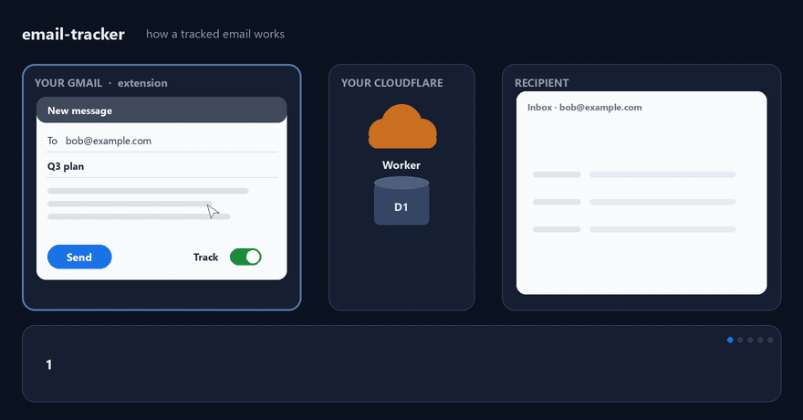
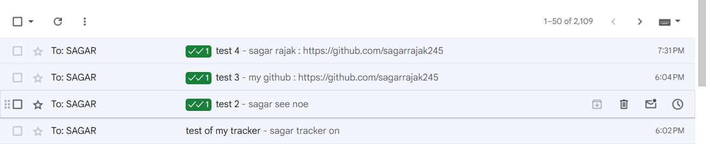
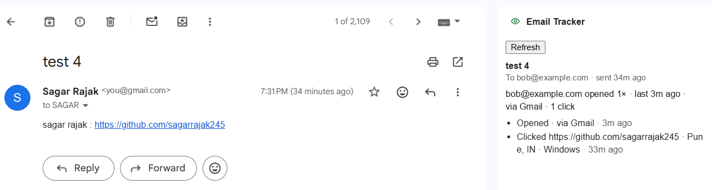

<div align="center">

# 👁️ email-tracker

**A free, self-hosted, Streak-style open & click tracker for Gmail.**

See who opened your email, when, how often, and which links they clicked.
Your data lives in your own Cloudflare account. No subscription, no third-party servers.

[](https://github.com/sagarrajak245/email-tracker/actions/workflows/ci.yml)
[](LICENSE)


[**Set it up in 15 minutes →**](#setup) · [How it works](#how-it-works) · [Limitations](#limitations) · [Privacy](#privacy-and-responsible-use)

<br>



</div>

## ✨ What you get

<table>
<tr>
<td width="50%" valign="top">

**Sent-list badges**

Tracked threads show `✓` (sent, not opened) or a green `✓✓ N` (opened N times), right in Gmail.



</td>
<td width="50%" valign="top">

**Thread sidebar**

Open a tracked thread and click the 👁️ icon on the right: every open and click, with time, rough place and device.



</td>
</tr>
</table>

| | |
|---|---|
| 🔔 **Desktop notifications** | "bob@x.com opened your email" or "Someone clicked a link", about 1–2 minutes after it happens. |
| 🎚️ **Track toggle in compose** | Turn tracking off for a single email, and set the default in the options. |
| 🙈 **Your own views are ignored** | Opens right after sending, your own reading in Gmail, and replies that quote your email aren't counted. |
| 🔗 **Link-click tracking** | Links are wrapped through your Worker, which logs the click and redirects instantly. |
| 💸 **Free forever** | Fits in the Cloudflare and InboxSDK free tiers. No credit card. |
| 🔐 **You own the data** | One Worker, one database, one token, all in your account. |

## 🧰 Before you start

You need:

| What | Why | Cost |
|---|---|---|
| [Node.js](https://nodejs.org/) 22 or newer (`node -v`) | build tools | free |
| [Git](https://git-scm.com/) | to clone the repo | free |
| A [Cloudflare account](https://dash.cloudflare.com/sign-up) | hosts the Worker and database | free plan |
| An [InboxSDK](https://www.inboxsdk.com/) app id | lets the extension hook into Gmail | free |
| Desktop Google Chrome | runs the extension | free |

Setup takes about 15 minutes. You don't need a credit card.

<a id="setup"></a>

## 🚀 Setup

### 1. Get the code

```bash
git clone https://github.com/sagarrajak245/email-tracker.git
cd email-tracker
npm install
```

(Or fork it first and clone your fork if you want to make changes.)

### 2. Deploy the Worker

Every command in steps 2–3 runs **inside `worker/`**.

```bash
cd worker
npx wrangler login
npm run deploy
```

`wrangler login` opens your browser so you can sign in to Cloudflare. Then `npm run deploy` does everything else:

1. finds your D1 database called `email-tracker`, or creates it on the first run;
2. saves its id to `worker/.env`;
3. writes `worker/wrangler.local.jsonc`, a copy of `wrangler.jsonc` with your database id;
4. creates the tables and deploys the Worker.

Both generated files are gitignored, so you never edit `wrangler.jsonc` (the `database_id` committed there is the
author's) and never commit your own. Run `npm run deploy` again anytime to redeploy. It's safe to repeat.

On your first deploy, Cloudflare may ask you to pick a `workers.dev` subdomain. The deploy prints your Worker's URL,
for example `https://email-tracker.<your-subdomain>.workers.dev`. **Save this URL.**

Check it works: open `https://email-tracker.<your-subdomain>.workers.dev/p/x.gif` in a browser. You should see a
blank page, which is the invisible 1×1 image.

> Prefer to pick the database yourself? Put `D1_DATABASE_ID=<id>` in `worker/.env` and the script uses that instead.

### 3. Set your API token

The token is the password between the extension and your Worker. Generate a long random one:

```bash
node -e "console.log(require('crypto').randomBytes(32).toString('hex'))"
```

Copy what it prints, then store it in the Worker. Wrangler asks you to paste the value:

```bash
npm run secret
```

Keep the token somewhere safe, like a password manager. You'll paste it into the extension in step 5. Never commit it.

### 4. Get an InboxSDK app id

Go to [inboxsdk.com](https://www.inboxsdk.com/) and register a free app (look for "Get App ID" or
"Register"). You'll get an id that starts with `sdk_`.

### 5. Build and load the extension

Go back to the repo root:

```bash
cd ..
npm run build -w extension
```

1. In Chrome, open `chrome://extensions`.
2. Turn on **Developer mode** (top right).
3. Click **Load unpacked** and select the **`extension/dist`** folder.
4. On the extension's card, click **Details → Extension options**. Fill in:
   - **Worker URL**: the URL from step 2;
   - **API token**: the token from step 3;
   - **InboxSDK app ID**: the `sdk_…` id from step 4.
5. Click **Save**. Chrome asks to allow access to your Worker; allow it. The page should say **"Saved and connected"**.
6. Reload any open Gmail tabs.

Done. Compose an email in Gmail and you'll see the **Track** toggle.

### 6. Try it

Send a tracked email to an address you read **on another device or in another browser**, such as your phone. Don't use a
second Gmail account in this same Chrome profile: the extension blocks every Gmail tab in this profile from loading
your pixel, so your own views don't count, and that block also covers other accounts.

Open the email there and click a link in it. Within about 2 minutes:
- the Sent badge reads `✓✓ 1`;
- the thread's sidebar lists the open and the click;
- a desktop notification pops up.

## 🔄 Updating

```bash
git pull
npm install
npm run build -w extension
```

Then click the ⟳ reload icon on the extension's card in `chrome://extensions`. If `worker/` changed, also run
`npm run deploy` from `worker/`. It applies any new migrations and redeploys.

## 🔑 Rotating the token

From `worker/`, run `npm run secret` with a new random value. Then paste the new value into the extension's
options and save.

<a id="troubleshooting"></a>

## 🩺 Troubleshooting

<details>
<summary>Something not working? Click for common fixes.</summary>

| Symptom | Fix |
|---|---|
| `npm run deploy` says "Missing script" or wrangler says "Worker name missing" | You ran it from the repo root. `cd worker` first. |
| Deploy fails with "not authenticated" | Run `npx wrangler login` (in `worker/`) and try again. |
| Deploy fails with "database not found" | `worker/.env` points at a database you don't have. Delete the `D1_DATABASE_ID` line and rerun `npm run deploy`. |
| Deploy asks which account to use, or fails with "more than one account" | Your login has several Cloudflare accounts. Add `CLOUDFLARE_ACCOUNT_ID=<id>` (from the dashboard sidebar) to `worker/.env` and rerun. |
| You ran plain `npx wrangler deploy` and it failed on the database | Plain wrangler uses the author's id from `wrangler.jsonc`. Use `npm run deploy`, or `npx wrangler … -c wrangler.local.jsonc`. |
| Options page says **unauthorized** | The token in the options doesn't match the `API_TOKEN` secret. Set it again (step 3). |
| Options page says **unreachable** | Check the Worker URL is `https://…workers.dev` with no path, and that you allowed the permission prompt. |
| No Track toggle in Gmail | Reload the Gmail tab. Check the app id is set. In Gmail press F12 and look for `[email-tracker]` messages in the Console. |
| Opens never show up | Did the recipient's mail app load images? Many block them until "Show images". Opens in this Chrome profile are ignored on purpose (step 6). |
| No notifications | Allow notifications for Chrome in your OS settings (Windows: Settings → System → Notifications; macOS: System Settings → Notifications). |
| Badges/sidebar stopped working after a Gmail update | InboxSDK may need a newer version: bump `@inboxsdk/core` in `extension/package.json`, then rebuild. |

</details>

<a id="limitations"></a>

## ⚠️ Limitations

Open tracking means "probably opened", not "definitely read". Streak and similar tools work the same way.

- **One email = one pixel.** With several recipients (To or Cc), it can only say "someone opened". A person is
  named only when there's exactly one recipient.
- **Gmail recipients' locations are hidden.** Gmail fetches images through Google's proxy, so their opens say "via
  Gmail". Link clicks and opens in other mail apps show the city and device.
- **Counts are a lower bound.** Gmail's proxy caches images, so repeat opens may not reach the Worker.
- **Some opens are false.** Apple Mail Privacy Protection and corporate link scanners can pre-load images and links.
- **Your other devices count as recipients.** Reading your sent email on your phone (no extension) looks like a recipient open.
- **Only the Gmail web UI is covered.** Mail sent from the Gmail mobile app or other clients isn't tracked.
- **Notifications can be missed.** Chrome must be running. A backlog arrives folded on the next poll. Rarely, a
  notification fires for an open that later turns out to be your own view.
- **Deliverability.** A `*.workers.dev` link domain can look spammy to some filters. Adding a
  [custom domain](https://developers.cloudflare.com/workers/configuration/routing/custom-domains/) to the Worker helps.

<a id="privacy-and-responsible-use"></a>

## 🛡️ Privacy and responsible use

All data lives in **your** Cloudflare account: the email subject, recipient addresses, open and click times, rough city,
and user agent. Nobody else, including the author, can see it. Anyone with your API token can read it, so keep
the token private.

Tracking pixels are common in marketing email, but people may not expect them in personal mail, and some laws (such as
GDPR or ePrivacy) may require consent depending on where you and your recipients are. Use it responsibly. You can turn tracking off
for any single email.

<a id="how-it-works"></a>

## ⚙️ How it works

<details>
<summary>Under the hood: pixel, links, self-view filtering and polling.</summary>

```
 Gmail (your Chrome)                     Cloudflare (your account, free)
 ┌──────────────────────────┐            ┌────────────────────────────────┐
 │ extension                │  register  │ Worker  ── D1 (SQLite)         │
 │  • adds pixel + links    │ ─────────▶ │  /p/<id>.gif   pixel           │
 │  • Sent badges, sidebar  │  stats     │  /c/<id>/<n>   link redirect   │
 │  • notifications         │ ◀───────── │  /api/*        token-protected │
 └──────────────────────────┘            └────────────────────────────────┘
                                             ▲ recipient opens / clicks
```

1. When you click Send, the extension cancels the send. It gives the email a random 22-character id, adds a
   1×1 pixel (`/p/<id>.gif`), rewrites links to `/c/<id>/<n>` and registers the email with the Worker.
   Then it sends. If registering fails, the email goes out untracked and you see a notice.
2. A pixel hit is logged in D1 as an open, and a link hit as a click. Hits from the same browser within a minute are deduped,
   and each email is capped at 60 opens per hour.
3. Opens within 15 s of sending, and within ±60 s of you viewing the thread yourself, are ignored when stats are
   read. Because this happens at read time, a late "that was me" still corrects the counts.
4. The extension's background service worker is the only part that holds the API token. It answers the Gmail page
   and polls `/api/events` every minute for notifications.

### Project layout

```
worker/      Cloudflare Worker (TypeScript) + D1 migrations
  src/       index.ts (routes) · track.ts (pixel/click) · api.ts (stats API) · auth.ts · validate.ts
  scripts/   deploy.mjs (find/create D1, generate wrangler.local.jsonc, migrate, deploy)
docs/        README images and make-demo.py (renders how-it-works.gif)
extension/   Chrome MV3 extension (TypeScript, InboxSDK, esbuild)
  src/       content.ts (Gmail UI) · background.ts (API, alarms, notifications) · options.ts
  static/    manifest.json, options.html, icons
```

</details>

## 🛠️ Development

```bash
npm install
npm test                    # all workspaces (Worker tests run in a local workerd)
npm run typecheck
npm run build -w extension  # outputs extension/dist
cd worker && npx wrangler dev   # local Worker; put API_TOKEN=... in worker/.dev.vars
```

The README animation is generated by `python docs/make-demo.py` (needs Pillow and ffmpeg).

Contributions are welcome. Open an issue or a PR. Please keep logic in small, tested modules (see
`extension/src/*.ts` and `extension/test/`) and run `npm test` and `npm run typecheck` before opening a PR.

## 📄 License

[MIT](LICENSE)
